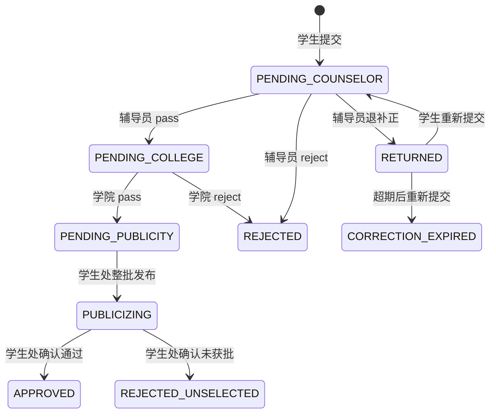

# 前端接口对接说明（Spring Boot 版）

> **面向对象**：前端同学
> **对应后端**：`backend/`，Spring Boot 3.3.5 + JPA + H2
> **状态**：与 `backend/` 源码逐条核对后编写，非推测
> **替代关系**：本文取代 `docs/前端接口对接说明.md` 与 `docs/前端接口对接说明-公示与结果.md`（那两份对应已移除的 Python 实现，仅作历史存档）

---

## 一、先看这五条差异，能省掉一半返工

如果你之前接过旧版（Python）接口，**下面五点全都变了**，按旧代码改会直接跑不通：

| 项 | 旧版（已移除） | 现在 |
| --- | --- | --- |
| 响应包装 | `{"ok":true,"data":...}` | **裸对象/裸数组**，没有 `ok`、没有 `data` |
| 错误体 | `{"ok":false,"error":{"code":"...","message":"..."}}` | **`{"message":"中文提示"}`**，靠 HTTP 状态码区分类型，**没有错误码常量** |
| 认证 | Cookie + `X-CSRF-Token` 双校验 | 登录返回随机令牌，后续使用 `X-Session-Token` 请求头；无 Cookie、无 CSRF |
| 时间格式 | 带时区的 ISO 字符串 | **不带时区的本地时间**，如 `2026-11-16T09:00` |
| 附件 | base64 上传 + 附件下载接口 | **没有文件概念**，`materials` 只是材料名称字符串数组 |

另外三个旧接口**不存在了**：`/api/session`、`/api/logout`、`/api/uploads`。登录态由前端自己保存（内存或 `localStorage`）。

---

## 二、通用约定

### 2.1 基址

```
http://localhost:8080
```

`backend/pom.xml` 与 `application.yml` 里端口写死 `8080`。前端若跑在 5173 / 3000，可直接跨域调用——`WebConfig` 已放开 `/api/**` 的 CORS（`allowedOrigins("*")`），无需代理。**注意**：放开 CORS 与不需要 Cookie 是配套的，别自己再加 `credentials: "include"`。

### 2.2 认证

1. `POST /api/auth/login` 登录，保存响应里的 `token`。
2. 之后**每个请求**都加：

```http
X-Session-Token: <登录响应中的 token>
```

3. 令牌保存在服务端内存，服务重启后需重新登录。前端退出登录会清掉本地存储。

### 2.3 错误处理

**统一形状**：

```json
{ "message": "驳回时必须填写驳回理由" }
```

**状态码含义**：

| 状态码 | 含义 | 前端动作 |
| --- | --- | --- |
| 200 | 成功（注意：**重复提交也是 200**，见 4.3） | 用响应体 |
| 400 | 业务规则不通过（缺字段、状态不对、时间窗关闭…） | 直接把 `message` 弹给用户 |
| 401 | 未登录或令牌无效 | 清本地登录态，回登录页 |
| 403 | 角色或数据范围不允许 | 提示"无权操作"，不要重试 |
| 404 | 对象不存在 | 刷新列表 |
| 500 | 服务端异常，`message` 为 `服务器处理失败` | 提示"服务异常"，记日志 |

**关键**：`400` 的 `message` 已经是可直接展示的中文，前端不要自己再拼一套文案，否则会和后端提示对不上。判断成功与否只看 `response.ok`（或 `status === 200`），不要去解析 `message` 内容做分支。

### 2.4 时间格式

后端字段类型是 `LocalDateTime`，序列化/反序列化都是 **ISO 本地时间、不带时区、不带 `Z`**：

```
2026-11-16T09:00:00
2026-11-16T09:00          ← 也接受，秒可省略
```

所以 `<input type="datetime-local">` 的 `value` **可以原样提交**，不需要 `new Date(v).toISOString()`——而且不能这么做：`toISOString()` 会带上 `Z`，后端 `LocalDateTime.parse` 会直接抛格式错误，返回 `公示开始时间格式不正确` 这类 `400`。

展示后端返回的时间时，直接取前 16 位把 `T` 换成空格即可，不要做时区换算。后端存的就是服务器本地时间；前后端不同机部署时需另行约定时区，本项目为本地演示不处理。

### 2.5 角色

`role` 字段返回枚举名，不是中文：

| 值 | 含义 |
| --- | --- |
| `STUDENT` | 学生 |
| `COUNSELOR` | 辅导员 |
| `COLLEGE` | 学院审核员 |
| `AFFAIRS` | 学生处 |

---

## 三、状态机

申请状态 `status` 返回枚举名，`statusLabel` 返回中文，**界面上请用 `statusLabel`**，别自己维护中英映射表。



| 枚举 | 中文 | 谁能推动 |
| --- | --- | --- |
| `PENDING_COUNSELOR` | 待辅导员审核 | 辅导员（通过 / 驳回 / 退补正）、学生（补正后重提） |
| `PENDING_COLLEGE` | 待学院复核 | 学院审核员（通过 / 驳回） |
| `PENDING_PUBLICITY` | 待公示 | 学生处（整批发布） |
| `PUBLICIZING` | 公示中 | 学生处（公示期结束后整批确认） |
| `APPROVED` / `REJECTED_UNSELECTED` | 已获批 / 未获批 | 终态 |
| `RETURNED` | 待补正 | 学生（补正后重提） |
| `CORRECTION_EXPIRED` | 补正逾期 | 终态 |
| `REJECTED` | 已驳回 | 终态 |

---

## 四、接口清单（18 条路径 / 26 个方法）

| # | 方法 | 路径 | 角色 |
| --- | --- | --- | --- |
| 1 | POST | `/api/auth/login` | 匿名 |
| 2 | GET | `/api/notices` | 已登录 |
| 3 | GET | `/api/notices/{id}` | 已登录 |
| 4 | POST | `/api/applications` | 学生 |
| 5 | GET | `/api/applications/mine` | 学生 |
| 6 | GET | `/api/applications/{id}` | 按角色范围 |
| 7 | POST | `/api/applications/{id}/resubmit` | 学生（本人） |
| 8 | GET | `/api/counselor/applications` | 辅导员 |
| 9 | POST | `/api/applications/{id}/counselor-review` | 辅导员 |
| 10 | POST | `/api/applications/{id}/correction` | 辅导员 |
| 11 | GET | `/api/college/applications` | 学院审核员 |
| 12 | POST | `/api/applications/{id}/college-review` | 学院审核员 |
| 13 | GET | `/api/publicity/candidates/{noticeId}` | 学生处 |
| 14 | POST | `/api/publicity/publish` | 学生处 |
| 15 | GET | `/api/publicity/{noticeId}` | 已登录（脱敏） |
| 16 | GET | `/api/publicity/{noticeId}/admin` | 学生处（不脱敏） |
| 17 | POST | `/api/publicity/{noticeId}/confirm` | 学生处 |
| 18 | GET | `/api/stats` | 学生处 |

### 4.1 登录

`POST /api/auth/login`

```json
{ "username": "zhang3", "password": "123456" }
```

响应 `200`（**扁平对象，没有包装层**）：

```json
{
  "id": 6,
  "username": "zhang3",
  "name": "张三",
  "role": "STUDENT",
  "studentNo": "202411701202",
  "college": "计算机学院",
  "token": "<随机令牌>"
}
```

失败：`400` `{"message":"请输入账号和密码"}` / `401` `{"message":"账号或密码错误"}`。

> 后续认证使用 `token`，用户 `id` 不再充当身份凭据。

### 4.2 通知列表 / 详情

`GET /api/notices` → 数组；`GET /api/notices/{id}` → 单个对象。**只返回已发布的通知**，未发布的直接 `404 {"message":"通知不存在或尚未发布"}`。

```json
{
  "id": 1,
  "projectName": "国家励志奖学金",
  "batchName": "2026年秋季批次",
  "level": "一等",
  "conditions": "全日制在校本科生，品学兼优且家庭经济困难，无违纪记录。",
  "materials": ["成绩单", "家庭经济困难证明", "学籍证明"],
  "applyStart": "2026-11-14T21:30:00",
  "applyEnd": "2026-11-22T21:30:00",
  "ended": false,
  "open": true,
  "publicized": false,
  "publicityStart": null,
  "publicityEnd": null
}
```

| 字段 | 说明 |
| --- | --- |
| `materials` | **必交材料名称列表**，提交申请时 `materials` 必须覆盖它 |
| `open` | 当前是否可申请（`applyStart <= now < applyEnd`） |
| `ended` | 是否已过截止时间（`now >= applyEnd`） |
| `publicized` | 该批次是否已发过公示 |

按钮状态直接用 `open` 控制，不要前端自己算时间。

### 4.3 提交申请

`POST /api/applications`

```json
{
  "noticeId": 1,
  "reason": "家庭经济困难，父母务农，申请国家励志奖学金。",
  "materials": ["成绩单", "家庭经济困难证明", "学籍证明"]
}
```

成功 `200`：

```json
{
  "duplicate": false,
  "message": "提交成功，申请编号：JZ20261115-A1B2C3",
  "application": { "...见 4.4 字段表" }
}
```

**重复提交也是 `200`**（不是 409）：

```json
{
  "duplicate": true,
  "message": "该批次已提交过申请，返回原申请编号：JZ20261115-A1B2C3",
  "application": { "..." }
}
```

> 前端必须判 `duplicate`：`true` 时提示"已提交过，编号是 xxx"并跳转到该申请详情，**不要显示成"提交成功"**。

错误（都是 `400`，`message` 可直接展示）：

- `请选择申请项目`
- `当前不在申请开放时间内（2026-11-14 21:30 至 2026-11-22 21:30）`
- `请填写申请理由`
- `缺少必需材料：学籍证明`（多个用 `、` 连接）

`404` `通知不存在或尚未发布`。

### 4.4 申请对象字段表

`application` 出现的地方（4.3 / 4.5 / 4.6 / 4.7 / 7.3 / 8.2）都是这个结构：

| 字段 | 类型 | 说明 |
| --- | --- | --- |
| `id` | number | 主键，用于调后续接口 |
| `applyNo` | string | 申请编号，给用户看的 |
| `studentId` / `studentName` / `studentNo` | | 学生信息 |
| `college` | string | 学院，学院审核员范围校验靠它 |
| `noticeId` | number | 所属批次 |
| `projectName` / `batchName` / `level` | string | 项目、批次、等级 |
| `reason` | string | 申请理由 |
| `materials` | string[] | 本次提交的材料名称 |
| `requiredMaterials` | string[] | 该批次要求的材料 |
| `status` | string | 枚举名，判断逻辑用 |
| `statusLabel` | string | 中文，**展示用这个** |
| `submitTime` | datetime | 提交时间 |
| `counselorOpinion` / `counselorReviewedAt` | | 辅导员意见与时间 |
| `collegeOpinion` / `collegeReviewedAt` | | 学院意见与时间 |
| `finalReason` | string \| null | 未获批原因，仅终态有值 |
| `confirmedAt` | datetime \| null | 学生处确认时间 |
| `correctionOpinion` | string \| null | 补正意见（辅导员填） |
| `correctionDeadline` | datetime \| null | 补正截止时间 |
| `prevMaterials` | string[] | 上一版材料，重新提交后才非空 |
| `correctionExpiredAt` | datetime \| null | 逾期终止时间 |

### 4.5 我的申请 / 申请详情

`GET /api/applications/mine` → 数组，按 id 倒序。

`GET /api/applications/{id}` → 单个。**可见范围由后端判定**：学生=本人；辅导员=自己负责的学生；学院审核员=本学院；学生处=全部。越权返回 `403 {"message":"无权查看该申请"}`，不存在 `404`。

### 4.6 重新提交（补正）

`POST /api/applications/{id}/resubmit`（仅本人、仅 `RETURNED` 状态）

```json
{ "reason": "已补充家庭经济困难证明。", "materials": ["成绩单", "家庭经济困难证明", "学籍证明"] }
```

响应 `200`：`{"message":"重新提交成功，申请编号不变：JZ...","application":{...}}`

错误：`403 只能操作本人的申请`、`400 当前状态不可重新提交` / `补正已截止，本轮申请终止` / `请填写申请理由` / `缺少必需材料：...`。

> 注意：逾期时后端会**先把状态改成 `CORRECTION_EXPIRED` 再返回 400**。前端收到"补正已截止"后应刷新详情，状态已变。

### 4.7 辅导员：列表 / 审核 / 退补正

`GET /api/counselor/applications` → 数组（该辅导员名下全部申请，含历史状态）。

`POST /api/applications/{id}/counselor-review`

```json
{ "action": "pass", "comment": "情况属实，同意。" }
```

`action` 只有两个值：`pass` / `reject`。`reject` 时 `comment` 必填。

响应 `200`：`{"message":"审核通过，已送交学院复核","application":{...}}`

错误：`403 只能审核自己负责的学生申请`、`400 当前状态为“已驳回”，不能重复审核` / `驳回时必须填写驳回理由` / `审核动作无效`。

`POST /api/applications/{id}/correction`（退补正）

```json
{ "opinion": "家庭经济困难证明缺少学院盖章，请补正后重新提交。", "deadline": "2026-11-20T18:00:00" }
```

响应 `200`：`{"message":"已退补，等待学生补正后重新提交","application":{...}}`

错误：`400 退补时必须填写补正意见` / `请设置补正截止时间` / `补正截止时间格式不正确` / `补正截止时间必须晚于当前时间` / `当前状态为“...”，不能发起退补`。

> `deadline` 必须是**未来**时间，且格式为 ISO 本地时间。前端 `<input type="datetime-local">` 的 `value` 可直接用。

### 4.8 学院审核员：列表 / 复核

`GET /api/college/applications` → 数组。

> ⚠️ 当前实现返回**本学院全部申请，不按状态过滤**，所以列表里会混有 `PENDING_COUNSELOR`（辅导员还没审的）。前端应按 `status === "PENDING_COLLEGE"` 决定是否渲染复核按钮，其余状态只读。这一点已在 PR #8 描述中列为待评审项。

`POST /api/applications/{id}/college-review`

```json
{ "action": "pass", "comment": "学院复核通过，同意上报。" }
```

响应 `200`：`{"message":"复核通过，已进入待公示","application":{...}}`

错误：`403 只能复核本学院的申请`、`400 当前状态为“待辅导员审核”，不能复核` / `驳回时必须填写驳回理由` / `复核动作无效`。

### 4.9 学生处：候选列表 / 发布公示

`GET /api/publicity/candidates/{noticeId}` → 数组（该批次全部申请，**未脱敏**，供勾选）。

`POST /api/publicity/publish`

```json
{
  "noticeId": 1,
  "start": "2026-11-16T09:00",
  "end": "2026-11-23T18:00",
  "applicationIds": [1, 2, 3]
}
```

响应 `200`：`{"message":"公示已发布，共 3 条记录进入公示中","count":3}`

错误（全部 `400`，且**整批不生效**）：

- `请设置公示起止时间`
- `公示结束时间必须晚于开始时间`
- `请选择要公示的记录`
- `以下记录不符合公示条件，已阻止整批发布：JZ2026...（待辅导员审核）；记录#5（不属于本批次）`

> 后端会校验所选记录恰好覆盖批次内全部 `PENDING_PUBLICITY` 记录；漏选、重复选择及重复发布均返回 400。前端仍应先展示完整候选列表，便于用户确认。

### 4.10 学生处：公示名单（脱敏）/ 管理视图（不脱敏）

`GET /api/publicity/{noticeId}` —— 任意登录用户可读，**已脱敏**：

```json
{
  "noticeId": 1,
  "projectName": "国家励志奖学金",
  "batchName": "2026年秋季批次",
  "level": "一等",
  "publicityStart": "2026-11-16T09:00:00",
  "publicityEnd": "2026-11-23T18:00:00",
  "list": [
    {
      "id": 2,
      "name": "张*",
      "studentNo": "********1202",
      "college": "计算机学院",
      "projectName": "国家励志奖学金",
      "batchName": "2026年秋季批次",
      "level": "一等",
      "statusLabel": "公示中"
    }
  ]
}
```

**脱敏规则**：

- 姓名：3 字及以上保留首尾各 1 字、中间打 `*`（`王小明` → `王*明`）；2 字保留首字（`张三` → `张*`）；单字全部打码（`*`）。
- 学号：只留后 4 位，其余打 `*`（`202411701202` → `********1202`）；长度 ≤ 4 时全部打码。

名单只包含 `PUBLICIZING` / `APPROVED` / `REJECTED_UNSELECTED` 三种状态的记录。

未发公示：`400 {"message":"该批次尚未发布公示"}`。

`GET /api/publicity/{noticeId}/admin` —— 仅学生处，形状同上，但 `list` 里是**完整申请对象**（见 4.4）。

### 4.11 学生处：整批确认最终结果

`POST /api/publicity/{noticeId}/confirm`

```json
{
  "disputeHandled": true,
  "items": [
    { "applicationId": 1, "approved": true },
    { "applicationId": 2, "approved": false, "reason": "综合测评排名未进入前 30%。" }
  ]
}
```

响应 `200`：

```json
{ "message": "最终结果已确认：获批 1 人，未获批 1 人", "approved": 1, "total": 2 }
```

后端四道校验，任一不过整批不变（`400`）：

| 校验 | 提示 |
| --- | --- |
| 已发公示 | `该批次尚未发布公示` |
| 公示期已结束 | `公示期尚未结束，不能确认最终结果（结束时间：2026-11-23 18:00）` |
| `disputeHandled === true` | `请先确认线下异议处理已完成` |
| `items` 覆盖全部公示中记录 | `必须覆盖该批次全部公示中记录，不允许遗漏或包含非公示中记录` |
| 未获批必须有原因 | `未获批记录必须填写原因（申请编号：JZ...）` |

> `applicationId` 取自 `GET /api/publicity/{noticeId}` 返回的 `list[].id`（脱敏名单里保留了 `id`，正是为了这一步）。也可以从 `/admin` 接口取。

### 4.12 学生处：统计

`GET /api/stats?noticeId=1&college=计算机学院`（`college` 可选，不传=全部）

```json
{
  "total": 3,
  "approved": 1,
  "statusCounts": { "PENDING_COUNSELOR": 0, "PENDING_COLLEGE": 1, "PENDING_PUBLICITY": 0, "PUBLICIZING": 1, "APPROVED": 1, "REJECTED_UNSELECTED": 0, "REJECTED": 0, "RETURNED": 0, "CORRECTION_EXPIRED": 0 },
  "groups": [
    { "projectName": "国家励志奖学金", "college": "计算机学院", "total": 2, "approved": 1, "statusCounts": { "...": 0 } }
  ],
  "message": "统计完成"
}
```

`statusCounts` **固定返回全部 9 个状态**（没有的补 0），可以直接用来画柱状图；无数据时 `message` 为 `无匹配数据，各项统计为 0`。

错误：`400 请选择统计批次`、`404 批次不存在`。

---

## 五、前端改造 checklist

登录与身份

- [ ] 删掉 `/api/session`、`/api/logout`、`X-CSRF-Token`、`credentials: "include"` 相关代码。
- [ ] 登录成功存 `token`，所有需认证请求统一加 `X-Session-Token` 头（建议封装在 `api()` 里）。
- [ ] 收到 `401` 统一清登录态回登录页。
- [ ] 按 `role` 分流：`STUDENT` / `COUNSELOR` / `COLLEGE` / `AFFAIRS` 四套入口。

响应解析

- [ ] 去掉 `body.ok` / `body.data` / `body.error.code` 的解析，改成 `if (!res.ok) throw new Error((await res.json()).message)`。
- [ ] 删除所有错误码常量表（`AUTH_REQUIRED`、`IMMEDIATE` 之类），改看状态码 + `message`。

状态展示

- [ ] 全部改用 `statusLabel` 渲染，删除前端自维护的中英文映射。
- [ ] 补齐 4 个新状态样式：`待补正`、`补正逾期`、`待公示`、`公示中`。

学生端

- [ ] 申请表单里 `materials` 从"上传文件"改为"勾选材料名称"，选项来自 `notice.materials`。
- [ ] 提交后判 `duplicate`：`true` → 提示已提交并跳详情；`false` → 正常成功提示。
- [ ] 新增"补正"入口：`status === "RETURNED"` 时显示 `correctionOpinion` 和 `correctionDeadline`，表单可改 `reason` + 重选材料，调 `/resubmit`。
- [ ] `prevMaterials` 非空时展示"上一版材料"对比。

辅导员端

- [ ] 审核表单三按钮：通过 / 驳回（理由必填）/ 退补正（意见 + 截止时间必填）。
- [ ] 退补正的截止时间用 `<input type="datetime-local">`，`min` 设为当前时间。

学院审核员端

- [ ] 列表按 `status === "PENDING_COLLEGE"` 决定是否可操作，其余只读。

学生处端

- [ ] 候选列表按 `status` 分组，只有 `PENDING_PUBLICITY` 可勾选，默认全选。
- [ ] 发布前校验"全部待公示记录都已选中"（后端目前不校验，见 4.9）。
- [ ] 公示时间用 `datetime-local`，直接提交，不做 `toISOString()`。
- [ ] 确认页：从 `/admin` 或脱敏名单取 `id`，逐条渲染"通过 / 不通过 + 原因"，`disputeHandled` 用复选框，提交前校验原因非空、条数等于 `total`。
- [ ] 公示期未结束时确认按钮置灰，显示 `publicityEnd`。
- [ ] 统计页直接消费 `statusCounts`（9 个键固定存在）。

---

## 六、联调十步（按顺序走一遍，全通即闭环）

前置：`cd backend && ./mvnw spring-boot:run`（Windows `mvnw.cmd`），首次启动自动建表 + 写演示数据。

1. `POST /api/auth/login` `zhang3/123456` → 拿到 `id`（演示库为 `6`），`role=STUDENT`。
2. `GET /api/notices` → 应有 2 条：`国家励志奖学金`（`open=true`）、`校级奖学金`（已截止，`ended=true`）。
3. `POST /api/applications` 提交 `noticeId=1` → `duplicate=false`，状态 `待辅导员审核`。
4. 再提交一次同批次 → **`duplicate=true`，状态码仍是 200**（不要当成报错）。
5. 换 `wangls/123456` 登录 → `GET /api/counselor/applications` 能看到第 3 步的申请；`counselor-review` 传 `pass` → 变 `待学院复核`。
6. 换 `jsxy/123456` 登录 → `GET /api/college/applications` 能看到；`college-review` 传 `pass` → 变 `待公示`。
7. 换 `xsc/123456` 登录 → `GET /api/publicity/candidates/1` 有数据；`POST /api/publicity/publish` 传该申请 id 与起止时间 → 该记录变 `公示中`。
8. `GET /api/notices/1` 确认 `publicized=true`；再以学生身份 `GET /api/publicity/1`，核对姓名学号已打码。
9. `POST /api/publicity/1/confirm` 逐条给结论（`disputeHandled=true`，未获批必须带 `reason`）→ 返回 `获批 N 人，未获批 M 人`。
10. `GET /api/applications/{id}` 状态变 `已获批` / `未获批`，`finalReason` 有值；`GET /api/publicity/1` 名单的 `statusLabel` 同步更新。

> **想验证"公示期未结束不能确认"这条规则**：用 `noticeId=1` 另起一次流程，把 `end` 设成未来时间发布，再调 `confirm`，应返回 `公示期尚未结束，不能确认最终结果（结束时间：...）`。这是正确行为，不是 bug。
>
> **想跳过等待做演示**：后端不校验 `end` 是否在未来，所以第 7 步直接把 `end` 设成 2 小时前，第 9 步就能立刻确认。两种时间都建议各测一次。

---

## 七、边界与已知限制（别当前端 bug 排查）

1. **没有文件上传**。旧版有 `POST /api/uploads`，新版只有材料名称数组。若要真做附件，需后端新增接口，不是前端能补的。
2. **登录令牌暂存内存**。后端重启会使令牌失效，需重新登录。
3. **发布必须覆盖全部待公示记录**（见 4.9），漏选或重复选择会被拒绝。
4. **学院列表未按状态过滤**（见 4.8），前端需自己判状态。
5. **无分页**。所有列表接口返回全量，数据量大了会卡，当前演示数据量级无影响。
6. **无审批留痕表**。审核意见直接存在 `applications` 的字段上，没有独立审计流水，同一申请只保留最新一次意见。
7. **演示数据只在库为空时写入**。想重置演示数据：停服务，删 `backend/data/`，重启。

---

## 八、示例请求速查

```bash
# 登录
curl -s -X POST localhost:8080/api/auth/login \
  -H 'Content-Type: application/json' \
  -d '{"username":"zhang3","password":"123456"}'

# 带身份的读取
curl -s localhost:8080/api/notices -H 'X-Session-Token: <学生登录返回的 token>'

# 学生处发公示
curl -s -X POST localhost:8080/api/publicity/publish \
  -H 'Content-Type: application/json' -H 'X-Session-Token: <学生处登录返回的 token>' \
  -d '{"noticeId":1,"start":"2026-11-15T09:00","end":"2026-11-22T18:00","applicationIds":[1]}'

# 整批确认
curl -s -X POST localhost:8080/api/publicity/1/confirm \
  -H 'Content-Type: application/json' -H 'X-Session-Token: <学生处登录返回的 token>' \
  -d '{"disputeHandled":true,"items":[{"applicationId":1,"approved":true}]}'
```

> 示例请求中的令牌应使用对应角色登录响应里的 `token`。
